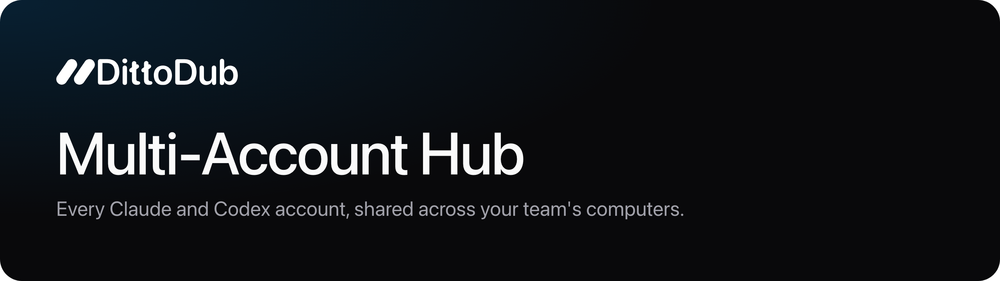
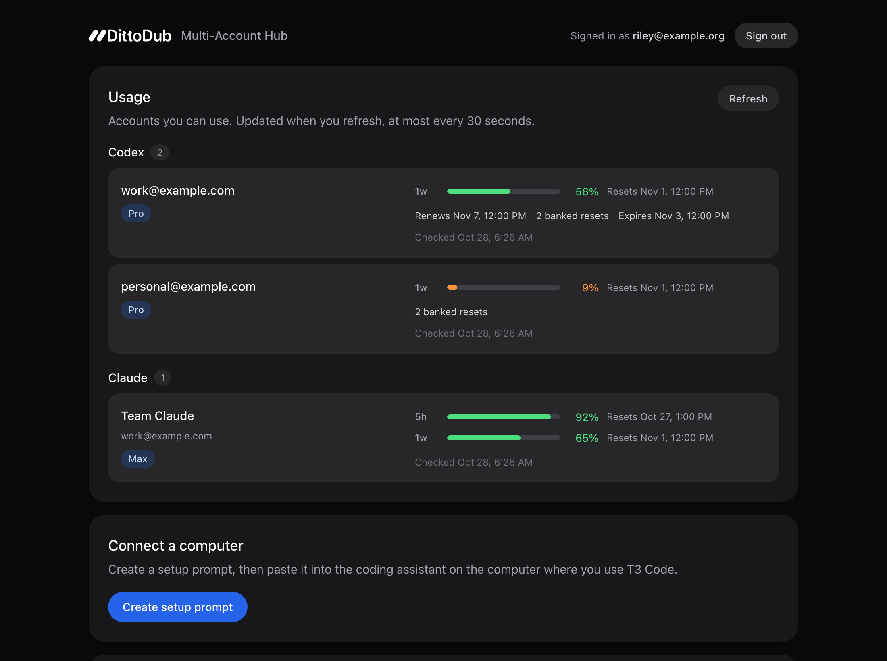

<p align="center"></p>

One always-on computer holds every Claude and Codex account your team has.
Every other computer connects to it with its own key: laptops, desktops,
servers. T3 Code shows each account's remaining usage and lets you spend Codex
reset credits from its usage panel.

Run it as a private hub over **Tailscale**, or add an optional **website**
where teammates sign in with Google, connect computers and add their own
accounts.

## Inspired by T3 Code

We spend our days in [T3 Code](https://t3.codes), and this hub grew out of it.
Theo's guide, [How I manage 7 Claude and 3 Codex accounts across 12+ computers](https://gist.github.com/t3dotgg/59a521d2ee8d70aaf90e280c175072af),
lays out the idea:

- Sign every account into one always-on box at home running
  [CLIProxyAPI](https://github.com/router-for-me/CLIProxyAPI).
- Point every machine at it over Tailscale.
- Let T3 Code read the pooled limits through its **Usage providers** setting.

It worked so well for one person that we wanted it for a whole team. T3 Code
shaped the result in three ways:

- **Usage where you work.** The hub speaks the same CLIProxy usage API that T3
  Code's usage panel reads. Each computer sees the accounts it can use, with
  live limits, reset times and banked Codex resets, and can redeem a reset
  without leaving T3.
- **Setup by prompt.** Connecting a computer means pasting one prompt into the
  coding agent you already use. The agent runs the setup script, which adds
  **HUB Codex** and **HUB Claude** providers to T3 Code and turns on usage
  automatically.
- **Same rules as the guide.** One home machine, no datacenter sign-ins,
  session affinity so prompt caches stay warm, and Codex over WebSockets.

What the hub adds for a team:

- **Personal or shared accounts.** Whoever connects an account decides whether
  it is personal (only ever used for them) or shared with the team.
  Administrators choose which shared accounts each person can use, but cannot
  reach anyone's personal account.
- **A key per computer.** Every computer gets its own key, and any one can be
  revoked without touching the others. The hub stores only hashes.
- **Watchdog and alerts.** A cron watchdog restarts stopped services and posts
  to Discord when a service, the public route or an account's sign-in needs
  attention.

> [!WARNING]
> Pooling subscriptions may break a provider's terms, and accounts can be
> banned. Keep Theo's two rules: never use the hub to serve other people's
> traffic, and use Claude subscriptions only from Claude Code. Run the hub at
> home, never on a VPS or behind a VPN.

<p align="center"></p>

## How it works

```
 T3 Code · Codex CLI · Claude Code      (one key per computer)
                 │
     Tailscale  ─┴─  or Cloudflare Tunnel + website
                 │
   gateway       checks the key → member → that member's accounts
                 │                (member keys never leave the hub)
   CLIProxyAPI   + key router: picks one of the member's accounts,
                 │               keeps sessions on the same account
   Anthropic · OpenAI
```

| Piece | What it does |
| --- | --- |
| `team-gateway.cjs` | The only listener clients reach. Authenticates computer keys, exposes only the model, usage and reset endpoints, and streams without logging bodies. |
| CLIProxyAPI + key router | Pinned upstream builds with local patches (`upstream/`) so each member can use only the accounts assigned to them. Requests fail closed if routing is unavailable. |
| `portal/` | Optional website: Google sign-in, setup prompts, connecting accounts, team access and computers. |
| `hub-admin.py` | Members, computers and account sharing from the hub's terminal. This is everything a Tailscale-only hub needs. |
| `watchdog.py`, `portal/run-monitor.cjs` | Availability checks, account sign-in health and Discord alerts. |
| `onboarding/`, `scripts/configure-t3-usage.cjs` | Client setup the hub serves with its own address filled in. |

## Choose a mode

|  | Tailscale only | Website |
| --- | --- | --- |
| Who can reach it | Devices on your tailnet | Anyone on the internet (every request still needs a key) |
| Signing in | None; the hub admin issues keys | Google Workspace accounts on your domain |
| Connecting a computer | `hub-admin.py add-device`, then `setup.sh --key` | Paste the setup prompt from the website |
| Connecting provider accounts | Hub terminal, then `hub-admin.py share` | In the browser |
| Extra services | none | Cloudflare Tunnel, Google OAuth client |

Both modes share the same gateway, router, admin tool and T3 Code integration,
and you can add the website later.

## Set up a hub

The hub runs on macOS with LaunchAgents. Keep the Mac plugged in, awake and
signed in. You need Node.js 24+, Python 3.9+, Xcode Command Line Tools and Go
(the build fetches the pinned toolchain).

**1. Build.** Clone into `~/.local/share/cliproxy-hub`, install the portal's
one dependency, then build the patched proxy, router and sign-in helper.
`--prepare-only` checks the patches without compiling.

```bash
git clone https://github.com/KeystoneScience/multi-account-hub ~/.local/share/cliproxy-hub
cd ~/.local/share/cliproxy-hub
npm ci --prefix portal --ignore-scripts --no-audit --no-fund
python3 scripts/build-upstream.py
```

Copy the artifacts from `.build/upstream-*/artifacts`:

- `cliproxyapi-guarded` and `cliproxyapi-auth-helper` go in the hub directory.
- The router goes at `plugins/key-router.dylib`.

**2. Configure.** Copy the examples, replace every placeholder, and keep secret
files mode `0600`:

| Copy | To | Notes |
| --- | --- | --- |
| `examples/hub.tailscale.example.json` *or* `examples/hub.example.json` | `hub.json` | The mode, the address clients use, and (website only) your Google Workspace domain |
| `examples/guarded-config.example.yaml` | `guarded-config.yaml` | Proxy settings: loopback only, router on, request logging off |
| `examples/gateway-users.example.json` | `gateway-users.json` | Start with `{"users": []}`; `add-member` fills it in |
| `examples/account-ownership.example.json` | `account-ownership.json` | Who owns each provider account |

Then:

- Put the proxy's management secret in `~/.cli-proxy-api/management-key`.
- Put a Discord webhook URL in `discord-webhook-url` to get alerts.

**3. Start the services.** In copies of `examples/launchd/*.plist.example`:

1. Replace `__HOME__` and check the Node and cloudflared paths.
2. Install them in `~/Library/LaunchAgents` and `launchctl bootstrap` them.

A Tailscale-only hub needs only `proxy`, `gateway`, `monitor` and
`cli-updates`. Then add the watchdog to your crontab:

```cron
* * * * * /usr/bin/python3 $HOME/.local/share/cliproxy-hub/watchdog.py >> $HOME/.local/share/cliproxy-hub/watchdog-cron.log 2>&1
```

**4a. Tailscale.** Serve the gateway to your tailnet. Set `hubUrl` in
`hub.json` to the resulting address, such as `https://hub.your-tailnet.ts.net`.

```bash
tailscale serve --bg --https=443 http://127.0.0.1:18317
```

**4b. Website.** Create a Cloudflare Tunnel to `http://127.0.0.1:18317` (see
`examples/tunnel.example.yaml`), and a Google OAuth web client whose redirect
URI is your `hubUrl` followed by `/`. Store its `GOOGLE_CLIENT_ID` and
`GOOGLE_CLIENT_SECRET` in the private file named by
`portal.googleCredentialsFile`. Then load the `portal` and `tunnel` agents.

**5. Add people and accounts.** Run these from the hub directory:

```bash
python3 hub-admin.py add-member alex alex@example.com --admin

# Sign a provider account in on the hub, then say who owns it and who can use it
./cliproxyapi-auth-helper -config guarded-config.yaml -codex-device-login
./cliproxyapi-auth-helper -config guarded-config.yaml -claude-login
python3 hub-admin.py accounts
python3 hub-admin.py share codex:you@example.com alex team
python3 hub-admin.py enable alex
```

New members automatically get every account shared with the team. A member
without any accounts starts disabled until one is shared or granted. On your
own record in `gateway-users.json`, set `"owner": true` so nobody can disable
you from the website. Once the website is running, teammates can connect their
own accounts in the browser instead.

**6. Connect computers.**

- **Website:** sign in, click **Create setup prompt**, and paste it into the
  coding agent on the computer that runs T3 Code.
- **Tailscale:** run `python3 hub-admin.py add-device alex "Alex's laptop"`. It
  prints a one-time key and the command to run on that computer:

```bash
setup_dir="$(mktemp -d)" && curl -fsS https://hub.your-tailnet.ts.net/setup-provider-hub.sh -o "$setup_dir/setup.sh" && bash "$setup_dir/setup.sh" --key
```

The script writes a private Codex home and a Claude launcher under
`~/.dittodub-provider-hub`. It prints the T3 Code settings for **HUB Codex**
and **HUB Claude**, and registers the hub as a T3 usage source. Keep T3 Code
running and Node.js 22+ installed while it runs. Rerunning it on a connected
computer only refreshes the usage setup.

## Day to day

```bash
python3 hub-admin.py list                 # members and the accounts they can use
python3 hub-admin.py devices [alex]       # registered computers
python3 hub-admin.py revoke-device ID     # cut off one computer
python3 hub-admin.py disable alex         # cut off a person
python3 hub-admin.py grant alex claude:team@example.com
python3 watchdog.py --verbose             # run every check now
node issue-login-link.cjs alex@example.com # website: one-time sign-in link
```

Changes apply to new requests, and requests already streaming may finish. To
retire an account, set `"disabled": true` in its file in `~/.cli-proxy-api`.
If a Codex account reports `token_invalidated`, sign it in again.

## Security notes

- **Loopback only.** The proxy, gateway and portal listen on loopback.
  Tailscale or Cloudflare is the only way in. The proxy's management API is
  never exposed.
- **Separate keys.** Computer keys and member routing keys are different. The
  gateway swaps one for the other, so a stolen laptop key can be revoked alone.
  Member keys never leave the hub.
- **Personal accounts stay personal.** They are owner-only for administrators
  too. The router fails closed if routing is unavailable.
- **Usage and resets.** These are re-authorized on every request. Reset
  redemption is idempotent across retries and restarts. Routing cooldowns
  clear only after the provider confirms a reset.
- **Logging.** Request-body logging is off. The gateway, portal and watchdog
  never log prompts, responses or credentials. Providers and your tunnel
  handle traffic under their own policies.
- **Website sessions.** Google sign-in binds the first verified Google account
  for each email. Sessions last seven days. Setup codes and login links are
  single-use, expire after two hours, and are stored only as hashes.

## Development

Tests use temporary directories and synthetic credentials:

```bash
node --test portal/*.test.cjs tests/*.test.cjs
python3 -m unittest discover -s tests -p '*_test.py'
python3 tests/gateway_integration.py
python3 tests/router_integration.py   # needs the built proxy and router
node tests/portal_preview_fixture.cjs # website preview at http://127.0.0.1:18765
```

Git tracks source only. `.gitignore` is an allowlist, so credentials, keys,
sessions, logs and `hub.json` stay local. Upstream sources and licenses are in
[THIRD-PARTY-NOTICES.md](THIRD-PARTY-NOTICES.md).

---

Built by [DittoDub](https://dittodub.com). The DittoDub name and logo belong
to DittoDub; if you fork this, replace them with your own.
