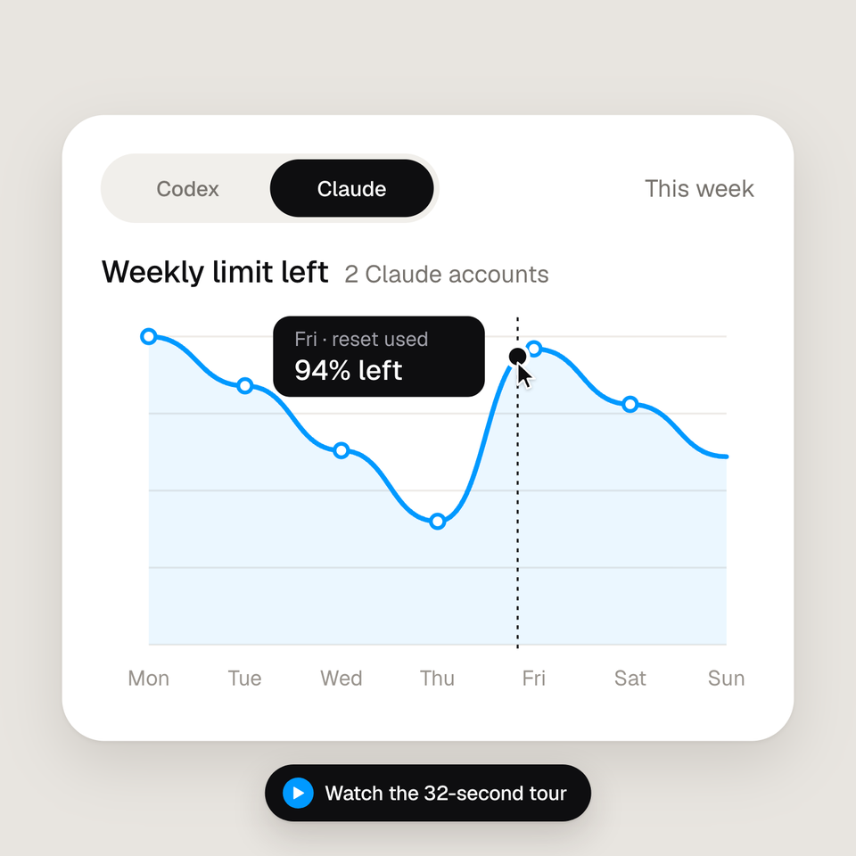
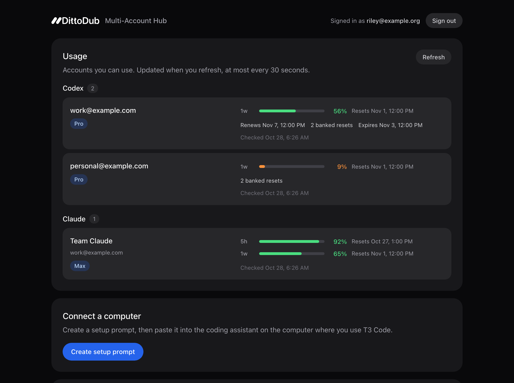

<p align="center"></p>

One always-on computer holds all your Claude and Codex accounts. Every
computer you work on connects to it with its own key: laptops, desktops,
servers. T3 Code shows each account's remaining usage and can spend Codex reset
credits from its usage panel.

It works for one person or for many:

- **Solo.** Sign each account in once, on one machine at home, and use them all
  from every computer you own.
- **Many solos, one hub.** Each person connects their own accounts, and those
  accounts stay theirs: only that person's computers use them. One hub runs
  everyone's setup, so nobody keeps their own box alive.

Run it privately over **Tailscale**, or add an optional **website** where people
sign in with Google, connect their computers and add their own accounts.

<p align="center"><a href="assets/multi-account-hub.mp4"></a><br><sub>Music: "Mechanichal Meaning of a Peanut" by Lemoneight, <a href="https://creativecommons.org/licenses/by/3.0/">CC BY 3.0</a></sub></p>

## Inspired by T3 Code

We spend our days in [T3 Code](https://t3.codes), and this hub grew out of it.
Theo's guide, [How I manage 7 Claude and 3 Codex accounts across 12+ computers](https://gist.github.com/t3dotgg/59a521d2ee8d70aaf90e280c175072af),
lays out the idea:

- Sign every account into one always-on box at home running
  [CLIProxyAPI](https://github.com/router-for-me/CLIProxyAPI).
- Point every machine at it over Tailscale.
- Let T3 Code read each account's limits through its **Usage providers**
  setting.

We wanted that for several people, each with their own accounts, without
everyone running a box. T3 Code shaped the result in three ways:

- **Usage where you work.** The hub speaks the CLIProxy usage API that T3 Code's
  usage panel reads. Each computer sees its accounts' live limits, reset times
  and banked Codex resets, and can redeem a reset without leaving T3.
- **Setup by prompt.** To connect a computer, paste one prompt into the coding
  agent you already use. The agent runs the setup script, which adds **HUB
  Codex** and **HUB Claude** providers to T3 Code and turns on usage.
- **Same rules as the guide.** One home machine, no datacenter sign-ins,
  session affinity so prompt caches stay warm, and Codex over WebSockets.

What the hub adds:

- **Accounts stay personal.** An account is used only for the person who
  connected it, and administrators can't change that. Its owner can choose to
  share it, but nothing is shared by default.
- **A key per computer.** Every computer gets its own key, and any one can be
  revoked without touching the others. The hub stores only hashes.
- **Watchdog and alerts.** A cron watchdog restarts stopped services and posts
  to Discord when a service, the public route or an account's sign-in needs
  attention.

> [!WARNING]
> Routing subscriptions through a proxy may break a provider's terms, and
> accounts can be banned. Keep Theo's two rules: use your subscriptions for
> your own work, never to serve anyone else's traffic, and use Claude
> subscriptions only from Claude Code. Run the hub at home, never on a VPS or
> behind a VPN.

<p align="center"></p>

## How it works

```
 T3 Code · Codex CLI · Claude Code      (one key per computer)
                 │
     Tailscale  ─┴─  or Cloudflare Tunnel + website
                 │
   gateway       checks the key → member → that member's accounts
                 │                (member keys never leave the hub)
   CLIProxyAPI   + key router: picks one of the member's accounts,
                 │               keeps sessions on the same account
   Anthropic · OpenAI
```

| Piece | What it does |
| --- | --- |
| `team-gateway.cjs` | The only listener clients reach. Authenticates computer keys, exposes only the model, usage and reset endpoints, and streams without logging bodies. |
| CLIProxyAPI + key router | Pinned upstream builds with local patches (`upstream/`) so each member can use only the accounts assigned to them. Requests fail closed if routing is unavailable. |
| `portal/` | Optional website: Google sign-in, setup prompts, connecting accounts, access settings and computers. |
| `hub-admin.py` | Members, computers and account sharing from the hub's terminal. This is everything a Tailscale-only hub needs. |
| `watchdog.py`, `portal/run-monitor.cjs` | Availability checks, account sign-in health and Discord alerts. |
| `onboarding/`, `scripts/configure-t3-usage.cjs` | Client setup the hub serves with its own address filled in. |

### Choosing an account

New sessions use a weighted choice among the member's permitted, available
accounts. More remaining quota gets more weight, which spreads load. Quota that
would otherwise expire unused gets up to eight times the weight: an account
with half its week left and a reset tomorrow leads over a freshly reset one,
which still gets a real share. Five-hour windows don't add this pull, because
their capacity comes back within hours. Every applicable window counts, so an
empty weekly quota cannot be offset by a full five-hour quota. Claude
model-specific limits apply only to that model family; Cowork limits do not
constrain coding requests.

New sessions avoid accounts within a 3% reserve when healthier accounts are
available. Healthy sessions stay on the same account for prompt caching, with a
one-hour idle timeout. Once a session's account drains into the reserve and
another permitted account is healthy, the session's next request moves there,
so members never reach the provider's usage-limit error. Without a healthy
alternative, the session keeps its account. A provider quota rejection before
streaming also retries another available account. Responses already streaming
are not replayed, which avoids duplicate output or tool calls.

Provider credits are a fallback. Some Codex accounts carry promotional or
purchased credits that let the provider keep serving an account after its plan
quota is used up. The router spends them only when every plan the member may
use for that provider is used up: until then, a used-up account stays out of
rotation even if it has credits. Primary accounts' credits are used before
access accounts'. A session on credits moves back to plan quota as soon as any
permitted plan has headroom again. Missing, stale or capped credit data never
counts as usable. Claude's equivalent, extra usage, is billed and stays off (see
below), so Claude accounts never fall back to credits.

The Usage section shows each account's credit balance, every grant with its
expiry date, and a provider total. The monitor compares credit balances on
every quota refresh. When an account's balance starts falling, Discord gets one
alert per spending episode (an episode ends after an hour without spending).
The alert says whether the hub fell back to credits or whether other plans
still had quota, which points to use outside the hub. The private
`credit-usage-watcher.json` keeps balances across restarts.

A transient upstream error (5xx or network) parks an account for 5 seconds
(`transient-error-cooldown-seconds` in `guarded-config.yaml`). When a member's
only usable accounts are parked like this, the request waits for the earliest
one to return, bounded by `max-retry-interval`, instead of failing with
`auth_unavailable`.

The monitor refreshes private quota data roughly once a minute into
`routing-usage.json`; selection makes no provider calls. Observations older
than three minutes become unknown, rather than looking like unlimited quota
or locking users out. Unknown accounts together receive at most 20% of new
sessions when known healthy alternatives exist. Missing telemetry preserves
existing session bindings and falls back to equal weighting for new sessions.

Weights use relative percentages, without guessing different plans' token
capacities. Accounts with banked Codex resets expiring within seven days receive
up to 4× the weight for new sessions. More available credits and nearer
expirations strengthen the preference, while actual quota and the 3% admission
reserve still apply. Credit details refresh every five minutes and when the
available count changes, with a separate 15-minute freshness limit. An uncertain
count change suppresses the credit bonus. Account priority and primary/access
permissions still apply.
Replacing the plugin resets its in-memory bindings once; normal quota updates
do not move healthy sessions.

The background monitor automatically redeems available banked Codex reset
credits 60 seconds before each credit expires, for every connected, enabled
Codex account, including accounts without member assignments. It discovers
accounts every 30 seconds, refreshes credit details every five minutes, and
checks known deadlines every second. Starting or waking inside the final
minute triggers an immediate attempt. The private `reset-credit-watcher.json`
stores deadlines and outcomes across restarts. Manual and automatic redemption
share a stable provider request ID, so retries cannot spend the same credit twice.
Transient failures and `nothing_to_reset` retry within the remaining minute;
provider retry hints are honored. Discord reports confirmed redemptions,
unavailable credits and missed expirations through the existing durable outbox.
If the provider has nothing to reset, the credit can still expire unused.
Only a confirmed successful reset followed by verified usable quota clears a
routing cooldown. This service never buys credits or interrupts model streams.

The website's Usage section shows quota percentage points burned per ten
minutes (averaged over the last 30 minutes), per hour (last hour), and per day
(last 24 hours). Each account uses its longest general quota window so overlapping
limits are not added together. The monitor samples in the background and keeps
one day of private history across restarts. Refills, reset crossings and gaps
longer than three minutes are excluded. Rates start after five observed minutes;
partial windows show their observed duration as history builds.

The monitor also checks Claude's paid extra usage setting. It discovers
connected Claude accounts every minute, including disabled or unassigned ones,
and checks each account's provider setting every five minutes. For Pro and Max
accounts, it disables extra usage if enabled and verifies the change. Anthropic
does not expose that switch for Team accounts through this OAuth API: an enabled
Team setting is recorded as `team_admin_required` for a Team admin to change.
The monitor never enables billing or buys credits. Failed checks use bounded
retries and remain explicitly unverified in
the private `claude-extra-usage-policy.json` status file; they do not interrupt
model streams. This periodic check cannot prevent a charge between someone
enabling extra usage outside the hub and the next successful check.

## Choose a mode

|  | Tailscale only | Website |
| --- | --- | --- |
| Who can reach it | Devices on your tailnet | Anyone on the internet (every request still needs a key) |
| Signing in | None; the hub admin issues keys | Google Workspace accounts on your domain |
| Connecting a computer | `hub-admin.py add-device`, then `setup.sh --key` | Paste the setup prompt from the website |
| Connecting provider accounts | Hub terminal, then `hub-admin.py share` | In the browser |
| Extra services | none | Cloudflare Tunnel, Google OAuth client |

Both modes share the same gateway, router, admin tool and T3 Code integration,
and you can add the website later.

## Set up a hub

The hub runs on macOS with LaunchAgents. Keep the Mac plugged in, awake and
signed in. You need Node.js 24+, Python 3.9+, Xcode Command Line Tools and Go
(the build fetches the pinned toolchain).

**1. Build.** Clone into `~/.local/share/cliproxy-hub`, install the portal's
one dependency, then build the patched proxy, router and sign-in helper.
`--prepare-only` checks the patches without compiling.

```bash
git clone https://github.com/RedAvocado/multi-account-hub ~/.local/share/cliproxy-hub
cd ~/.local/share/cliproxy-hub
npm ci --prefix portal --ignore-scripts --no-audit --no-fund
python3 scripts/build-upstream.py
```

Copy the artifacts from `.build/upstream-*/artifacts`:

- `cliproxyapi-guarded` and `cliproxyapi-auth-helper` go in the hub directory.
- The router goes at `plugins/key-router.dylib`.

**2. Configure.** Copy the examples, replace every placeholder, and keep secret
files mode `0600`:

| Copy | To | Notes |
| --- | --- | --- |
| `examples/hub.tailscale.example.json` *or* `examples/hub.example.json` | `hub.json` | The mode, the address clients use, and (website only) your Google Workspace domain |
| `examples/guarded-config.example.yaml` | `guarded-config.yaml` | Proxy settings: loopback only, router on, request logging off |
| `examples/gateway-users.example.json` | `gateway-users.json` | Start with `{"users": []}`; `add-member` fills it in |
| `examples/account-ownership.example.json` | `account-ownership.json` | Who owns each provider account |

Then:

- Put the proxy's management secret in `~/.cli-proxy-api/management-key`.
- Put a Discord webhook URL in `discord-webhook-url` to get alerts.

**3. Start the services.** In copies of `examples/launchd/*.plist.example`:

1. Replace `__HOME__` and check the Node and cloudflared paths.
2. Install them in `~/Library/LaunchAgents` and `launchctl bootstrap` them.

A Tailscale-only hub needs only `proxy`, `gateway`, `monitor` and
`cli-updates`. Then add the watchdog to your crontab:

```cron
* * * * * /usr/bin/python3 $HOME/.local/share/cliproxy-hub/watchdog.py >> $HOME/.local/share/cliproxy-hub/watchdog-cron.log 2>&1
```

**4a. Tailscale.** Serve the gateway to your tailnet. Set `hubUrl` in
`hub.json` to the resulting address, such as `https://hub.your-tailnet.ts.net`.

```bash
tailscale serve --bg --https=443 http://127.0.0.1:18317
```

**4b. Website.** Create a Cloudflare Tunnel to `http://127.0.0.1:18317` (see
`examples/tunnel.example.yaml`), and a Google OAuth web client whose redirect
URI is your `hubUrl` followed by `/`. Store its `GOOGLE_CLIENT_ID` and
`GOOGLE_CLIENT_SECRET` in the private file named by
`portal.googleCredentialsFile`. Then load the `portal` and `tunnel` agents.

To serve the same website on another address, add it to `alternateUrls` and
to `portal.additionalSites`, route its hostname through the tunnel, and add
its redirect URI (by default the address followed by `/oauth/callback`) to the
Google OAuth client. Each address signs in on its own, with its own session.

```json
"alternateUrls": ["https://hub.example.net"],
"portal": {
  "workspaceDomain": "example.com",
  "additionalSites": [{"url": "https://hub.example.net"}]
}
```

**5. Add people and accounts.** Run these from the hub directory:

```bash
python3 hub-admin.py add-member alex alex@example.com --admin

# Sign a provider account in on the hub, then say who owns it and who can use it
./cliproxyapi-auth-helper -config guarded-config.yaml -codex-device-login
./cliproxyapi-auth-helper -config guarded-config.yaml -claude-login
python3 hub-admin.py accounts
python3 hub-admin.py share codex:alex@example.com alex personal
python3 hub-admin.py enable alex
```

A member without any accounts starts disabled until one is connected for
them, then `enable` turns them on. If an owner has chosen to share an account,
new members get it automatically. On your
own record in `gateway-users.json`, set `"owner": true` so nobody can disable
you from the website. Once the website is running, people can connect their
own accounts in the browser instead.

**6. Connect computers.**

- **Website:** sign in, click **Create setup prompt**, and paste it into the
  coding agent on the computer that runs T3 Code. On a computer without
  T3 Code, use **Copy with instructions to install T3 Code** instead. It adds
  the full macOS install, enrollment, recovery and verification guide, so the
  agent installs T3 Code, Node.js, Codex and Claude, enrolls with the same
  one-time code, links every existing MCP server, skill and plugin into the
  HUB homes, and confirms both HUB providers in fresh conversations.
- **Tailscale:** run `python3 hub-admin.py add-device alex "Alex's laptop"`. It
  prints a one-time key and the command to run on that computer:

```bash
setup_dir="$(mktemp -d)" && curl -fsS https://hub.your-tailnet.ts.net/setup-provider-hub.sh -o "$setup_dir/setup.sh" && bash "$setup_dir/setup.sh" --key
```

The script creates private HUB authentication and runtime homes under
`~/.dittodub-provider-hub`, registers **HUB Codex** and **HUB Claude** in
T3 Code, syncs the advertised coding models, and registers the hub as a T3
usage source. Keep T3 Code running with Codex and Claude installed, and
Node.js 22+ available. Reruns repair sharing, migrate older installations,
sync models, and refresh usage without consuming another setup code or
replacing existing credentials.

HUB Codex links these common files and folders to PERSONAL's `~/.codex`:
`config.toml`, `skills`, `plugins`, and `AGENTS.md`. This shares MCP
registrations, plugin installation metadata/cache, skills, instructions,
and future edits/additions. HUB Claude continues to link its skills to
`~/.claude/skills`. Missing source folders and empty config/instruction
files are created. Existing PERSONAL files are never rewritten by setup.
Changing common settings through either Codex environment changes both.

HUB `auth.json`, the device key, sessions, history, and other runtime files
stay separate. The private `codex/hub-connection.json` records the endpoint;
it contains no key. Usage setup reads the private HUB auth/device key,
never PERSONAL authentication or a credential from the shared config.
MCP registrations are shared, but integrations that store their own OAuth
credentials per home may require a separate sign-in.

T3's supported Codex `config.launchArgs` supplies explicit HUB provider,
endpoint, file-based authentication, and API-key login overrides. A stable
provider identifier unique to the HUB home avoids inheriting auth fields
from other provider tables: Codex merges tables even with CLI overrides.
Keep this generated provider definition out of PERSONAL config. Setup
rejects a collision with that identifier. The overrides contain no secrets,
follow existing user arguments, and are not duplicated on reruns. PERSONAL's
default provider and authentication are preserved. Launch Codex through the
configured HUB provider in T3; setting `CODEX_HOME` alone does not select
HUB routing.

Model discovery reads the authenticated hub `/v1/models` endpoint. OpenAI
coding models go to Codex; Anthropic Claude models go to Claude. Image/audio
models and internal helpers are excluded. Missing coding models are added
through T3's supported custom-model settings. Existing custom models,
provider names, unrelated launch arguments, disabled states, model preferences,
and other providers are preserved. Matching providers are reused by their
configured home. Provider ID collisions, malformed launch arguments,
`shadowHomePath`, and explicit `T3CODE_CODEX_LAUNCH_ARGS` overrides are
reported for resolution rather than silently overwritten. An override
in T3's own process environment also needs to be removed there.

Migration accepts the old generated minimal HUB config or an owned HUB
config link directly to `~/.codex/config.toml` with private HUB auth/device
credentials. Before linking, it backs up the old minimal config and empty
or built-in-only folders under `~/.dittodub-provider-hub/backups`. Those
backups can contain the old device credential and remain private.
Custom HUB config, plugins, skills, or instructions stop migration before
enrollment. Preserve common settings by merging them into PERSONAL, or
keep HUB-only overrides in T3 launch arguments, then move the old path
aside and rerun. Do not copy HUB credential fields into PERSONAL.
Unexpected/broken links, symlinked PERSONAL source paths, unsafe private
files, and disagreeing HUB credentials are rejected. Interrupted setup
can be rerun using the saved private connection.

Both `setup-provider-hub.sh` and `setup-hub-usage.cjs` migrate the standard
HUB home. Older nonstandard Codex-only homes remain Codex-only and keep their
config; their usage and T3 startup routing are updated. Missing standard
Claude companion files are recreated without replacing existing credentials.

Setup saves explicit routing before sharing config, then refreshes T3's
provider catalog and checks enabled provider readiness and advertised
models. This refresh is discovery, not a guarantee that an existing cached
Codex process or conversation reloads its environment. Use a fresh provider
process/conversation to load the shared environment; if T3 reuses a stale
process, recover or restart that provider through T3. The installer does
not restart T3 or terminate active conversations. Rerun setup when new hub
models or account access are added; catalog sync is not continuous.

To verify onboarding without touching user state:

```bash
node --test tests/hub_environment.test.cjs tests/model_setup.test.cjs tests/usage_setup.test.cjs
python3 tests/setup_google_test.py
python3 tests/setup_skills_test.py
HUB_TEST_CODEX_BINARY=/absolute/path/to/codex python3 tests/codex_environment_test.py
```

The optional last test launches a real Codex app-server with disposable
homes, synthetic credentials, and local mock HTTP. It checks effective
startup routing, auth isolation, and shared MCP config without a T3 session.

## Day to day

```bash
python3 hub-admin.py list                 # people and the accounts they use
python3 hub-admin.py devices [alex]       # registered computers
python3 hub-admin.py revoke-device ID     # cut off one computer
python3 hub-admin.py disable alex         # cut off a person
python3 hub-admin.py grant alex claude:alex@example.com
python3 watchdog.py --verbose             # run every check now
node issue-login-link.cjs alex@example.com # website: one-time sign-in link
```

Changes apply to new requests, and requests already streaming may finish. To
retire an account, set `"disabled": true` in its file in `~/.cli-proxy-api`.
If a Codex account reports `token_invalidated`, sign it in again.

### Usage API

`GET /v1/usage` on the hub address, with a member's hub API key, returns every
account that member may use. Nobody else's accounts are included, and no
credentials or internal file names appear.

```bash
curl -s https://hub.example.com/v1/usage -H "Authorization: Bearer $HUB_KEY"
```

Each entry in `accounts` has:

| Field | Meaning |
| --- | --- |
| `id`, `provider`, `email`, `plan` | Which account (`id` is an opaque hash). |
| `windows[]` | `label` (`5h`, `1w`, `1mo`, or a Claude model family), `remaining` percent, and `resetsAt`. |
| `burnRates` | Quota percentage points used per 10 minutes, hour and day (`tenMinutes`, `hour`, `day`), each with `percent`, `observedSeconds` and `windowSeconds`; `basis` names the window measured. `percent` is `null` until five minutes are observed. |
| `bankedResets`, `resetExpirations[]` | Codex banked resets and when each expires. |
| `renewsAt` | When the subscription renews, if known. |
| `credits` | `balance`, `usable`, and `grants[]` with each grant's `remaining`, `granted` and `expiresAt` (Codex); Claude reports `extraUsage` instead. |
| `checkedAt`, `stale` | When the provider was last read; `stale` means the latest read failed or is old. |

Burn rates use the monitor's background history, so they work without the
website being open.

## Security notes

- **Loopback only.** The proxy, gateway and portal listen on loopback.
  Tailscale or Cloudflare is the only way in. The proxy's management API is
  never exposed.
- **Separate keys.** Computer keys and member routing keys are different. The
  gateway swaps one for the other, so a stolen laptop key can be revoked alone.
  Member keys never leave the hub.
- **Personal accounts stay personal.** They are owner-only for administrators
  too. The router fails closed if routing is unavailable.
- **Usage and resets.** These are re-authorized on every request. Reset
  redemption is idempotent across retries and restarts. Routing cooldowns
  clear only after the provider confirms a reset.
- **Logging.** Request-body logging is off. The gateway, portal and watchdog
  never log prompts, responses or credentials. Providers and your tunnel
  handle traffic under their own policies.
- **Website sessions.** Google sign-in binds the first verified Google account
  for each email. Sessions last seven days. Setup codes and login links are
  single-use, expire after two hours, and are stored only as hashes.

## Development

Tests use temporary directories and synthetic credentials:

```bash
node --test portal/*.test.cjs tests/*.test.cjs
python3 -m unittest discover -s tests -p '*_test.py'
python3 tests/gateway_integration.py
python3 tests/router_integration.py   # needs the built proxy and router
node tests/portal_preview_fixture.cjs # website preview at http://127.0.0.1:18765
```

Git tracks source only. `.gitignore` is an allowlist, so credentials, keys,
sessions, logs and `hub.json` stay local. Upstream sources and licenses are in
[THIRD-PARTY-NOTICES.md](THIRD-PARTY-NOTICES.md).

---

Built by [DittoDub](https://dittodub.com). [MIT licensed](LICENSE). The
DittoDub name and logo are not covered by the license; if you fork this,
replace them with your own.
